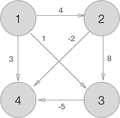

# All-Pairs Shortest Paths
# 任意两点间的最短路径

The All-Pairs shortest path problem simultaneously computes the shortest path from each node in the graph to each other node, provided a path exists for each pair. In the naive approach, we could simply compute a single-source shortest path from each node to each other node. The number of shortest paths computed is then bound by `O(V^2)`, where `V` is the number of vertices in the graph. Because SSSP is also bounded by `O(V^2)`, the total running time for the naive approach would be `O(V^4)`.
如果每对都存在路径，则All-Pairs最短路径问题同时计算从图中的每个节点到每个其他节点的最短路径。在天真的方法中，我们可以简单地计算从每个节点到每个其他节点的单源最短路径。 计算出的最短路径的数量然后由`O(V^2)`约束，其中`V`是图中顶点的数量。 因为SSSP也受到`O(V^2)`的限制，所以朴素方法的总运行时间将是`O(V^4)`。

However, by applying a dynamic approach on the adjacency matrix of the graph, a running time of `O(V^3)` is achievable, using the `Floyd-Warshall` algorithm. Floyd-Warshall iterates through an adjacency matrix, and for each pair of start(`i`) and end(`j`) vertices it considers if the current distance between them is greater than a path taken through another vertex(`k`) in the graph (if paths `i` ~> `k` and `k` ~> `j` exist). It moves through an adjacency matrix for every vertex `k` applying its comparison for each pair (`i`, `j`), so for each `k` a new adjacency matrix `D(k)` is derived, where each value `d(k)[i][j]` is defined as:
然而，通过在图的邻接矩阵上应用动态方法，使用`Floyd-Warshall`算法可以实现 `O(V^3)` 的运行时间。Floyd-Warshall遍历一个邻接矩阵，对于每对起点（`i`）和end（`j`）顶点，它考虑它们之间的当前距离是否大于通过另一个顶点（`k`）的路径 在图中（如果存在路径`i`~>`k`和`k`~>`j`）。 它为每个顶点`k`移动一个邻接矩阵，对每一对（`i`, `j`）应用它的比较，因此对于每个`k`，导出一个新的邻接矩阵`D(k)`，其中每个值 `d(k)[i][j]`定义为：

where `w[i][j]` is the weight of the edge connecting vertex `i` to vertex `j` in the graph's original adjacency matrix.
其中`w[i][j]`是图的原始邻接矩阵中连接顶点`i`到顶点`j`的边的权重。

When the algorithm memoizes each refined adjacency and predecessor matrix, its space complexity is `O(V^3)`, which can be optimised to `O(V^2)` by only memoizing the latest refinements. Reconstructing paths is a recursive procedure which requires `O(V)` time and `O(V^2)` space.
当算法记忆每个精确的邻接和前趋矩阵时，其空间复杂度为 `O(V^3)`，只需记忆最新的精化就可以优化为`O(V^2)`。 重构路径是一个递归过程，需要`O(V)`时间和`O(V^3)`空间。

# Example
# 例子

For the following weighted directed graph
对于以下加权有向图

the adjacency matrix representation `w` is
邻接矩阵表示 `w` 是

### Calculating shortest paths' weights
### 计算最短路径的权重

At the beginning of the algorithm, `D(0)` is the same as `w`, with the following exceptions to accommodate the comparison function:
在算法的开头，`D(0)`与`w`相同，但以下例外情况适用于比较函数：

1. vertices with no path connecting them have the `ø` replaced with `∞`
2. the diagonal has all `0`s

1. 没有连接它们的路径的顶点将`ø`替换为`∞`
2. 对角线全部为`0`

Here are all the adjacency matrices derived when perform Floyd-Warshall on the above graph:
以下是在上图中执行Floyd-Warshall时得出的所有邻接矩阵：

with the last being the result, which tells for each pair of starting and ending vertices, the total weight of the shortest path connecting them. During the step where `k = 2`, the comparison that winds up changing the top right value from `2` to `-4` goes like this:
最后一个是结果，它告诉每对起始和结束顶点，连接它们的最短路径的总重量。 在`k = 2`的步骤中，将右上角值从`2`更改为`-4`的比较如下：

	k = 2, i = 0, j = 3
	d(k-1)[i][j] => d(1)[0][3] = 2
	d(k-1)[i][k] => d(1)[0][2] = 1
	d(k-1)[j][k] => d(1)[2][3] = -5

therefore `min(2, 2 + -5) => min(2, -4)` produces a new weight of `-4` for the element at `d(2)[0][3]`, meaning that the shortest known path 1 ~> 4 before this step was from 1 -> 2 -> 4 with a total weight of -2, and afterwards we discovered a shorter path from 1 -> 3 -> 4 with a total weight of -4.
因此 `min(2, 2 + -5) => min(2, -4)` 为`d(2)[0][3]`的元素产生一个新的`-4`权重，意味着 在该步骤之前，最短的已知路径1 ~> 4是从1 -> 2 -> 4，总重量为-2，然后我们发现从1 -> 3 -> 4的较短路径，总重量为-4。

### Reconstructing shortest paths
### 重建最短路径

This algorithm finds only the lengths of the shortest paths between all pairs of nodes; a separate bookkeeping structure must be maintained to track predecessors' indices and reconstruct the shortest paths afterwards. The predecessor matrices at each step for the above graph follow:
该算法只找到所有节点对之间最短路径的长度; 必须保持一个单独的簿记结构，以跟踪前人的指数并重建之后的最短路径。 上图的每个步骤的前任矩阵如下：

# Project Structure
# 项目结构

The provided xcworkspace allows working in the playground, which imports the APSP framework target from the xcodeproj. Build the framework target and rerun the playground to get started. There is also a test target in the xcodeproj.
提供的xcworkspace允许在playground上工作，操场从xcodeproj导入APSP框架目标。 构建框架目标并重新运行操场以开始。 xcodeproj中还有一个测试目标。

In the framework:

- protocols for All-Pairs Shortest Paths algorithms and results structures
- an implementation of the Floyd-Warshall algorithm

- All-Pairs Shortest Paths算法和结果结构的协议
- Floyd-Warshall算法的实现

# TODO

- Implement naive `O(V^4)` method for comparison
- Implement Johnson's algorithm for sparse graphs
- Implement other cool optimized versions

- 实现天真的 `O(V^4)` 方法进行比较
- 为稀疏图实现Johnson的算法
- 实施其他酷炫优化版本

# References
# 参考

Chapter 25 of Introduction to Algorithms, Third Edition by Cormen, Leiserson, Rivest and Stein [https://mitpress.mit.edu/books/introduction-algorithms](https://mitpress.mit.edu/books/introduction-algorithms)
Cormen，Leiserson，Rivest和Stein的第三版算法导论第25章[https://mitpress.mit.edu/books/introduction-algorithms](https://mitpress.mit.edu/books/introduction-algorithms)

*Written for Swift Algorithm Club by [Andrew McKnight](https://github.com/armcknight)*

*作者：[Andrew McKnight](https://github.com/armcknight)*  
*翻译：[Andy Ron](https://github.com/andyRon)*  
