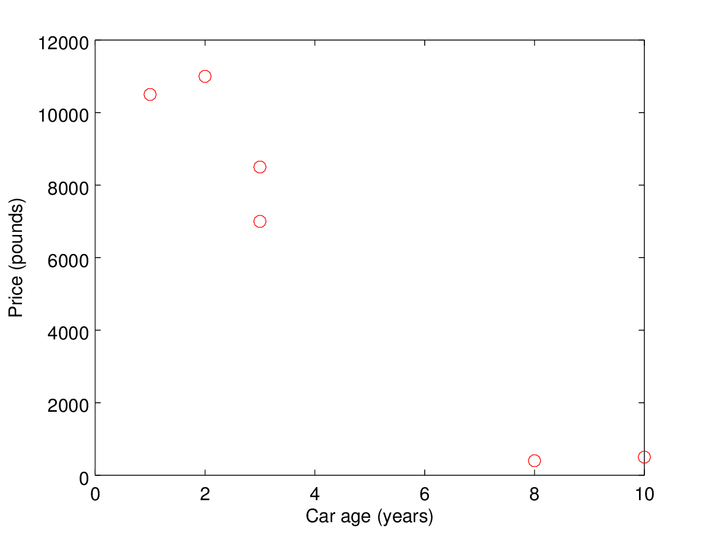
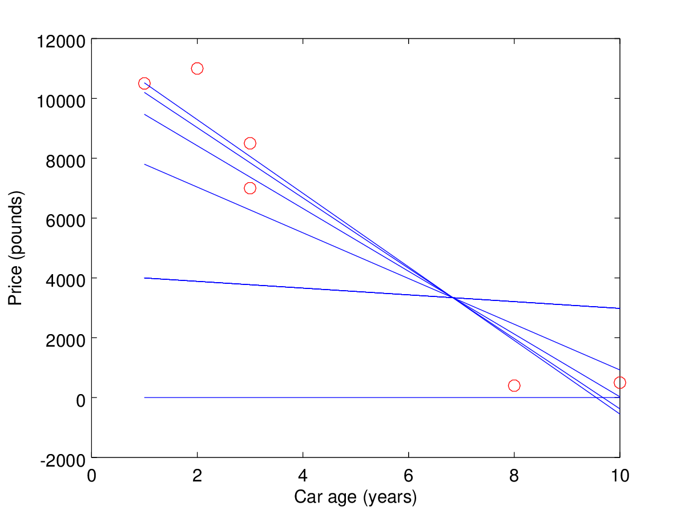
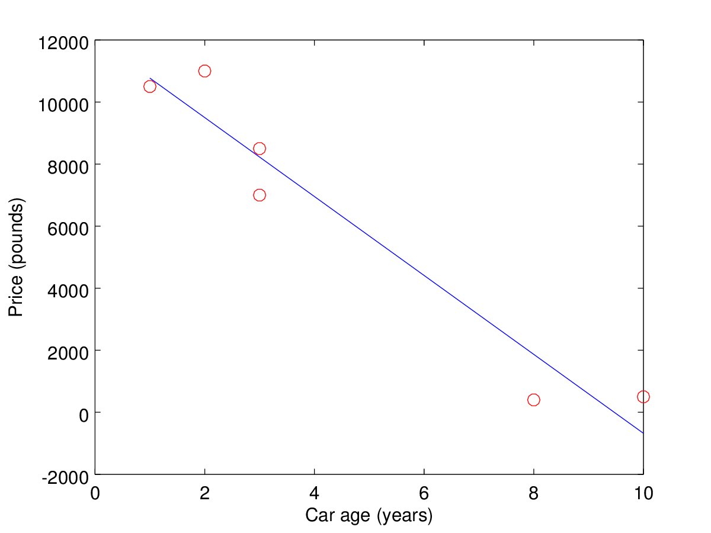

# 线性回归(Linear Regression)

Linear regression is a technique for creating a model of the relationship between two (or more) variable quantities.

For example, let's say we are planning to sell a car. We are not sure how much money to ask for. So we look at recent advertisments for the asking prices of other cars. There are a lot of variables we could look at - for example: make, model, engine size. To simplify our task, we collect data on just the age of the car and the price:

线性回归是一种用于创建两个（或更多）变量之间的关系模型的技术。

例如，假设我们计划出售一辆汽车。 我们不确定需要多少钱。 所以我们看看最近其他汽车要价的广告。 我们可以看到很多变量 - 例如：make，model，engine size。 为了简化我们的任务，我们收集的数据仅包括汽车的使用年限和价格：

Age (in years)| Price (in £)
--------------|-------------
10 | 500
8 | 400
3 | 7,000
3 | 8,500
2 | 11,000
1 | 10,500

Our car is 4 years old. How can we set a price for our car based on the data in this table?
我们的车已有4年历史。 我们如何根据此表中的数据为我们的汽车设定价格？

Let's start by looking at the data plotted out:
让我们从查看的数据开始：



We could imagine a straight line drawn through the points on this graph. It's not (in this case) going to go exactly through every point, but we could place the line so that it goes as close to all the points as possible.
我们可以想象通过该图上的点绘制的直线。 它不是（在这种情况下）完全通过每个点，但我们可以放置线，使其尽可能接近所有点。

To say this in another way, we want to make the distance from the line to each point as small as possible. This is most often done by minimising the square of the distance from the line to each point.

换句话说，我们希望从线到每个点的距离尽可能小。 这通常通过最小化从线到每个点的距离的平方来完成。

We can describe the straight line in terms of two variables:

1. The point at which it crosses the y-axis i.e. the predicted price of a brand new car. This is the *intercept*.
2. The *slope* of the line - i.e. for every year of age, how much does the price change.

我们可以用两个变量来描述直线：

1. 它穿过y轴的点，即一辆全新汽车的预测价格。 这是*拦截*。
2. 线的*斜率*  - 即每年的年份，价格变化多少。


This is the equation for our line:

这是我们行的等式：

`carPrice = slope * carAge + intercept`

How can we find the best values for the intercept and the slope? Let's look at two different ways to do this.

我们怎样才能找到截距和斜率的最佳值？ 让我们看看两种不同的方法来做到这一点。


## An iterative approach 一种迭代的方法
One approach is to start with some arbitrary values for the intercept and the slope. We work out what small changes we make to these values to move our line closer to the data points. Then we repeat this multiple times. Eventually our line will approach the optimum position.

一种方法是从截距和斜率的一些任意值开始。 我们计算出对这些值做出的小改动，以使我们的线更靠近数据点。 然后我们重复多次。 最终我们的线将接近最佳位置。

First let's set up our data structures. We will use two Swift arrays for the car age and the car price:

首先让我们设置我们的数据结构。 我们将使用两个Swift数组用于汽车时代和汽车价格：

```swift
let carAge: [Double] = [10, 8, 3, 3, 2, 1]
let carPrice: [Double] = [500, 400, 7000, 8500, 11000, 10500]
```

This is how we can represent our straight line:

这就是我们如何代表我们的直线：

```swift
var intercept = 0.0
var slope = 0.0
func predictedCarPrice(_ carAge: Double) -> Double {
    return intercept + slope * carAge
}

```
Now for the code which will perform the iterations:

现在为执行迭代的代码：

```swift
let numberOfCarAdvertsWeSaw = carPrice.count
let numberOfIterations = 100
let alpha = 0.0001

for _ in 1...numberOfIterations {
    for i in 0..<numberOfCarAdvertsWeSaw {
        let difference = carPrice[i] - predictedCarPrice(carAge[i])
        intercept += alpha * difference
        slope += alpha * difference * carAge[i]
    }
}
```

```alpha``` is a factor that determines how much closer we move to the correct solution with each iteration. If this factor is too large then our program will not converge on the correct solution.

```alpha```是一个决定每次迭代我们移动到正确解决方案的距离的因素。 如果这个因素太大，那么我们的程序将无法收敛于正确的解决方案。

The program loops through each data point (each car age and car price). For each data point it adjusts the intercept and the slope to bring them closer to the correct values. The equations used in the code to adjust the intercept and the slope are based on moving in the direction of the maximal reduction of these variables. This is a *gradient descent*.

程序循环遍历每个数据点（每个汽车年龄和汽车价格）。 对于每个数据点，它会调整截距和斜率，使它们更接近正确的值。 在代码中用于调整截距和斜率的等式基于在这些变量的最大减少方向上移动。 这是一个*梯度下降*。

We want to minimise the square of the distance between the line and the points. We define a function `J` which represents this distance - for simplicity we consider only one point here. This function `J` is proportional to `((slope.carAge + intercept) - carPrice)) ^ 2`.

我们希望最小化线和点之间的距离的平方。 我们定义了一个代表这个距离的函数`J`  - 为简单起见，我们在这里只考虑一个点。 这个函数`J`与`（（slope.carAge + intercept） -  carPrice））^ 2`成比例。

In order to move in the direction of maximal reduction, we take the partial derivative of this function with respect to the slope, and similarly for the intercept. We multiply these derivatives by our factor alpha and then use them to adjust the values of slope and intercept on each iteration.

为了在最大缩减的方向上移动，我们对于斜率采用该函数的偏导数，并且类似地对于截距。 我们将这些导数乘以我们的因子α，然后使用它们来调整每次迭代时的斜率和截距值。

Looking at the code, it intuitively makes sense - the larger the difference between the current predicted car Price and the actual car price, and the larger the value of ```alpha```, the greater the adjustments to the intercept and the slope.

看一下代码，它直观有意义 - 当前预测的汽车价格和实际汽车价格之间的差异越大，`alpha`的价值越大，截距和坡度的调整越大。

It can take a lot of iterations to approach the ideal values. Let's look at how the intercept and slope change as we increase the number of iterations:

可能需要大量迭代才能达到理想值。 让我们看看截距和斜率如何随着迭代次数的增加而变化：

Iterations | Intercept | Slope | Predicted value of a 4 year old car
:---------:|:---------:|:-----:|:------------------------:
0 | 0 | 0 | 0
2000 | 4112 | -113 | 3659 
6000 | 8564 | -764 | 5507 
10000 | 10517 | -1049 | 6318 
14000 | 11374 | -1175 | 6673 
18000 | 11750 | -1230 | 6829 

Here is the same data shown as a graph. Each of the blue lines on the graph represents a row in the table above.

以下是与图表相同的数据。 图中的每条蓝线代表上表中的一行。



After 18,000 iterations it looks as if the line is getting closer to what we would expect (just by looking) to be the correct line of best fit. Also, each additional 2,000 iterations has less and less effect on the final result - the values of the intercept and the slope are converging on the correct values.

经过18,000次迭代后，看起来这条线越来越接近我们所期望的（只是通过观察）才能成为最佳拟合线。 此外，每增加2,000次迭代对最终结果的影响越来越小 - 截距和斜率的值会收敛于正确的值。

## A closed form solution  封闭形式的解决方案

There is another way we can calculate the line of best fit, without having to do multiple iterations. We can solve the equations describing the least squares minimisation and just work out the intercept and slope directly. 

我们可以通过另一种方式计算最佳拟合线，而无需进行多次迭代。 我们可以求解描述最小二乘最小化的方程，并直接计算截距和斜率。

First we need some helper functions. This one calculates the average (the mean) of an array of Doubles:

首先，我们需要一些辅助函数。 这个计算双打数组的平均值（平均值）：

```swift
func average(_ input: [Double]) -> Double {
    return input.reduce(0, +) / Double(input.count)
}
```
We are using the ```reduce``` Swift function to sum up all the elements of the array, and then divide that by the number of elements. This gives us the mean value.

我们使用```reduce``` Swift函数来总结数组的所有元素，然后将它除以元素的数量。 这给了我们平均值。

We also need to be able to multiply each element in an array by the corresponding element in another array, to create a new array. Here is a function which will do this:

我们还需要能够将数组中的每个元素乘以另一个数组中的相应元素，以创建新数组。 这是一个将执行此操作的函数：

```swift
func multiply(_ a: [Double], _ b: [Double]) -> [Double] {
    return zip(a,b).map(*)
}
```

We are using the ```map``` function to multiply each element.

我们使用```map```函数来乘以每个元素。

Finally, the function which fits the line to the data:

最后，适合行数据的函数：

```swift
func linearRegression(_ xs: [Double], _ ys: [Double]) -> (Double) -> Double {
    let sum1 = average(multiply(ys, xs)) - average(xs) * average(ys)
    let sum2 = average(multiply(xs, xs)) - pow(average(xs), 2)
    let slope = sum1 / sum2
    let intercept = average(ys) - slope * average(xs)
    return { x in intercept + slope * x }
}
```
This function takes as arguments two arrays of Doubles, and returns a function which is the line of best fit. The formulas to calculate the slope and the intercept can be derived from our definition of the function `J`. Let's see how the output from this line fits our data:

该函数将两个Doubles数组作为参数，并返回一个最佳拟合线的函数。 计算斜率和截距的公式可以从我们对函数`J`的定义中导出。 让我们看看这一行的输出如何适合我们的数据：



Using this line, we would predict a price for our 4 year old car of £6952.

使用这条线，我们预测我们4岁车的价格为6952英镑。


## Summary 摘要
We've seen two different ways to implement a simple linear regression in Swift. An obvious question is: why bother with the iterative approach at all? 

我们已经看到了两种在Swift中实现简单线性回归的方法。 一个显而易见的问题是：为什么要依赖迭代方法呢？

Well, the line we've found doesn't fit the data perfectly. For one thing, the graph includes some negative values at high car ages! Possibly we would have to pay someone to tow away a very old car... but really these negative values just show that we have not modelled the real life situation very accurately. The relationship between the car age and the car price is not linear but instead is some other function. We also know that a car's price is not just related to its age but also other factors such as the make, model and engine size of the car. We would need to use additional variables to describe these other factors. 

好吧，我们找到的那条线并不完全符合数据。 首先，图表包含高汽车时代的一些负值！ 可能我们不得不付钱给某人拖走一辆非常旧的汽车......但实际上这些负面价值只是表明我们没有非常准确地模拟现实生活情况。 汽车年龄与汽车价格之间的关系不是线性的，而是一些其他功能。 我们也知道汽车的价格不仅与其年龄有关，还与其他因素有关，例如汽车的品牌，型号和发动机尺寸。 我们需要使用其他变量来描述这些其他因素。

It turns out that in some of these more complicated models, the iterative approach is the only viable or efficient approach. This can also occur when the arrays of data are very large and may be sparsely populated with data values.

事实证明，在一些更复杂的模型中，迭代方法是唯一可行或有效的方法。 当数据数组非常大并且可能稀疏地填充数据值时，也会发生这种情况。

*Written for Swift Algorithm Club by James Harrop*


*作者：James Harrop*  
*翻译：[Andy Ron](https://github.com/andyRon)*