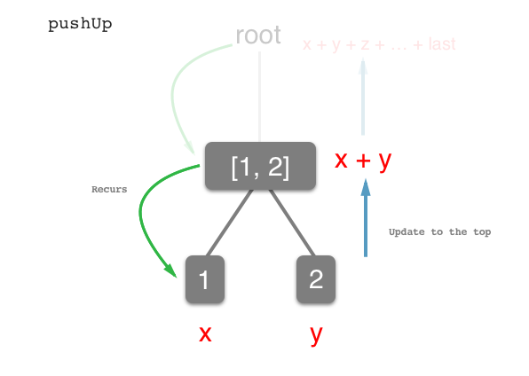
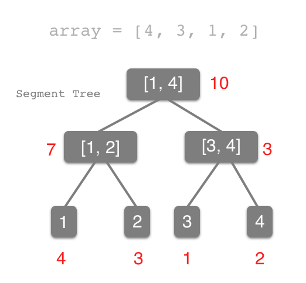
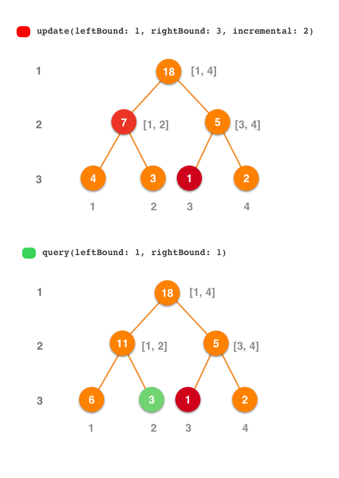
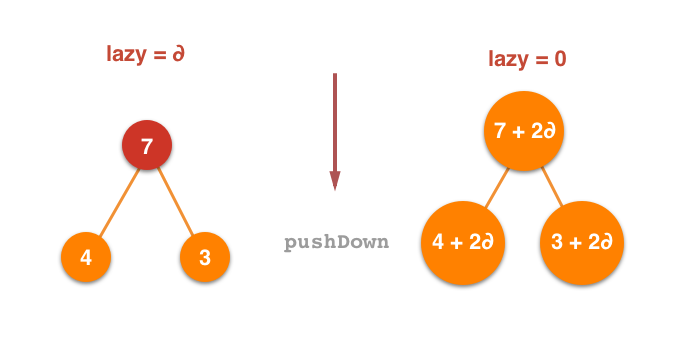

# Lazy Propagation in Segment Tree
# 线段树中的懒惰的传播

In previous implement about the Segment Tree by **Artur Antonov**, it's a strong data structure with *Generic* `<T>`. And we can pass a closure parameter `function: (T, T) -> T` to reflect the relationship between parent and child node. And in particular, Generic can solve multiple strings stitching problem. It's just like the sample in Playground:
在之前关于**Artur Antonov**的线段树的实现中，它是一个强大的数据结构，带有*泛型* `<T>`。 我们可以传递一个闭包参数`function:(T, T) -> T`来反映父节点和子节点之间的关系。 特别是，泛型可以解决多个字符串拼接问题。 它就像 Playground 中的样本：

```swift
stringSegmentTree.replaceItem(at: 0, withItem: "I")
stringSegmentTree.replaceItem(at: 1, withItem: " like")
stringSegmentTree.replaceItem(at: 2, withItem: " algorithms")
stringSegmentTree.replaceItem(at: 3, withItem: " and")
stringSegmentTree.replaceItem(at: 4, withItem: " swift")
stringSegmentTree.replaceItem(at: 5, withItem: "!")
print(stringSegmentTree.query(leftBound: 0, rightBound: 5))
// "I like algorithms and swift!"
```

The use of `<T>` is so exciting. But we seldom use the Segment Tree to solve string problem instead of *Suffix Array*. And the Segment Tree is a kind of *Interval Tree* to solve the Interval Problem in mathemtics and statistics, which is a structure for storing intervals, or segments, and allows querying which of the stored segments contain a given point. A segment tree for a set *I* of n intervals uses `O(nlogn)` storage and can be built in `O(nlogn)` time. Segment trees support searching for all the intervals that contain a query point in O(log n+k), k being the number of retrieved intervals or segments.
使用`<T>`是如此令人兴奋。 但是我们很少使用线段树来解决字符串问题而不是 *Suffix Array*。 并且线段树是一种*Interval Tree*来解决mathemtics和statistics中的Interval Problem，它是一种存储间隔或段的结构，并允许查询哪些存储的段包含给定的点。 n个区间的集合*I*的分段树使用`O(nlogn)`存储，并且可以在`O(nlogn)`时间内构建。 段树支持搜索包含O(log n+k)中的查询点的所有间隔，k是检索的间隔或段的数量。

But that is common Segment Tree. By **Lazy Propagation**, we can implement to modify an interval in `O(logn)` time. Let's explore together in following:
但这是常见的细分树。 通过**Lazy Propagation**，我们可以实现在`O(logn)`时间内修改间隔。 让我们一起探讨如下：

## `PushUp` - update to the top

At first, we reference the implement of **Artur Antonov** about Segment Tree. This code contained *build*, *single update* and *interval query* three operation. The implement of *build* and *single update* operation is following:
首先，我们参考**Artur Antonov**关于线段树的实现。 此代码包含*build*，*single update*和*interval query*三个操作。 *build*和*single update*操作的实现如下：

```swift
// Author: Artur Antonov
public init(array: [T], leftBound: Int, rightBound: Int, function: @escaping (T, T) -> T) {
	self.leftBound = leftBound
	self.rightBound = rightBound
	self.function = function
	// ①
	if leftBound == rightBound {
		value = array[leftBound]
	} 
	// ②
	else {
		let middle = (leftBound + rightBound) / 2
		leftChild = SegmentTree<T>(array: array, leftBound: leftBound, rightBound: middle, function: function)
		rightChild = SegmentTree<T>(array: array, leftBound: middle+1, rightBound: rightBound, function: function)
		value = function(leftChild!.value, rightChild!.value)
	}
}
```

In position ①, it means the current node is *leaf* because its left bound data is equal to the right. So we assign a value to it directly. In position ②, it means the current node is *parent* (which has one or more children), and we need to recursion down and update current node's data in the follow-up process.
在位置①，它表示当前节点是*leaf*，因为它的左边界数据等于右边。 所以我们直接给它赋值。 在位置②，它表示当前节点是*parent*（有一个或多个子节点），我们需要递归并在后续过程中更新当前节点的数据。

And then, we have a look for *interval query* operation:
然后，我们来看看*interval query*操作：

```swift
// Author: Artur Antonov
public func query(leftBound: Int, rightBound: Int) -> T {
	if self.leftBound == leftBound && self.rightBound == rightBound {
		return self.value
	}
	guard let leftChild = leftChild else { fatalError("leftChild should not be nil") }
	guard let rightChild = rightChild else { fatalError("rightChild should not be nil") }
	// ①
	if leftChild.rightBound < leftBound {
		return rightChild.query(leftBound: leftBound, rightBound: rightBound)
	} 
	// ②
	else if rightChild.leftBound > rightBound {
		return leftChild.query(leftBound: leftBound, rightBound: rightBound)
	}
	// ③ 
	else {
		let leftResult = leftChild.query(leftBound: leftBound, rightBound: leftChild.rightBound)
		let rightResult = rightChild.query(leftBound:rightChild.leftBound, rightBound: rightBound)
		return function(leftResult, rightResult)
	}
}
```

Position ① means that the left bound of current query interval is on the  right of this right bound, so recurs to right direction. Position ② is opposite of position ①, recurs to left direction. Position ③ means our check interval is included the interval we need, so recurs deeply.
位置①表示当前查询间隔的左边界位于此右边界的右侧，因此重复到右边方向。 位置②与位置①相反，向左方向重复。 位置③表示我们的检查间隔包含在我们需要的间隔内，因此深度重复。



There are common part from the two parts of code above - **recurs deeply below, and update data up**. So we can decouple this operation named `func pushUp(lson: LazySegmentTree, rson: LazySegmentTree)`:
上面代码的两个部分有共同的部分 - **在下面深入重复，并且更新数据**。 所以我们可以解耦这个名为`func pushUp(lson: LazySegmentTree, rson: LazySegmentTree)`的操作：

```swift
// MARK: - Push Up Operation
private func pushUp(lson: LazySegmentTree, rson: LazySegmentTree) {
    self.value = lson.value + rson.value
}
```

(This code only describe the *Sum Segment Tree*)

And then, we can update the implement before:

```swift
public init(array: [Int], leftBound: Int, rightBound: Int) {
    self.leftBound = leftBound
    self.rightBound = rightBound
    self.value = 0
    self.lazyValue = 0
    
    guard leftBound != rightBound else {
        value = array[leftBound]
        return
    }
    
    let middle = leftBound + (rightBound - leftBound) / 2
    leftChild = LazySegmentTree(array: array, leftBound: leftBound, rightBound: middle)
    rightChild = LazySegmentTree(array: array, leftBound: middle + 1, rightBound: rightBound)
    if let leftChild = leftChild, let rightChild = rightChild {
        pushUp(lson: leftChild, rson: rightChild)
    }
}
// MARK: - One Item Update
public func update(index: Int, incremental: Int) {
    guard self.leftBound != self.rightBound else {
        self.value += incremental
        return
    }
    guard let leftChild  = leftChild  else { fatalError("leftChild should not be nil") }
    guard let rightChild = rightChild else { fatalError("rightChild should not be nil") }
    
    let middle = self.leftBound + (self.rightBound - self.leftBound) / 2
    
    if index <= middle { leftChild.update(index: index, incremental: incremental) }
    else { rightChild.update(index: index, incremental: incremental) }
    pushUp(lson: leftChild, rson: rightChild)
}
```

## `PushDown` - Lazy Propagation 

You may feel that the `pushUp` is so simple. In fact, this's just to lead `pushDown` this function.

Before this, I want to talk about the topic about **interval operation**. The interval operation is a way to update all elements of a continuous subset. But these isn't in the version of **Artur Antonov**. You might disdain with this, because it's solved with a `for` loop:

您可能会觉得`pushUp`非常简单。 实际上，这只是为了引导`pushDown`这个功能。

在此之前，我想谈谈关于**间隔操作的话题**。 间隔操作是更新连续子集的所有元素的一种方法。 但这些不是**Artur Antonov**的版本。 你可能会不屑于此，因为它是通过`for`循环解决的：

```swift
// Sample: update the elements with subscript [2, 5] 
for index in 2 ... 5 {
    sumSegmentTree.update(index: index, incremental: 3)
}
```

It is a `O(n)` time operation, which make the interval operation uses `O(nlogn)` time to update these elements. We need a `O(logn)` way to maintain the elegance of Segment Tree. 

 Check the data structure of Segment Tree again:

它是一个`O(n)`时间操作，它使间隔操作使用`O(nlogn)`时间来更新这些元素。 我们需要一种`O(logn)`方式来保持线段树的优雅。

再次检查Segment Tree的数据结构：
 
 
 
We only catch the root node in programming. If we want to explore the bottom of the tree, and use `pushUp` to update every node, the task will be reached. So it asked us to traverse the tree, that spent `O(n)` time to do this with any way. This can't conform our expectations.  
我们只在编程中捕获根节点。 如果我们想要探索树的底部，并使用`pushUp`来更新每个节点，那么将会到达任务。 因此，它要求我们遍历树，花费`O(n)`的时间以任何方式做到这一点。 这不符合我们的期望。

Then we started to think about `pushDown` to update down from the root. **After we update the parent, the data continued to distributed to its children according to law.** But it still need `O(n)` time to do this. Keep thinking, we **only update the parent, and to update the children when `query` time**. Yeah, that's the key of **lazy propagation**. Because the recursing direct of the `query` and `update interval` is same. So we got it! 😁 Let's check this sample:
然后我们开始考虑`pushDown`从根更新。 **在我们更新父母之后，数据继续依法分发给孩子们。**但是仍然需要`O(n)`时间来做这件事。 继续思考，我们**只更新父级**，并在`query` time 时更新子级。 是的，这是**懒惰传播的关键**。 因为`query`和`update interval`的递归直接相同。 所以我们明白了！ 😁我们来看看这个样本：



`update` make the subscript 1...3 elements plus 2, so we make the 1st node in 2 depth and 3rd in 3 depth get a *lazy mark*, which means these node need to be updated. And we shouldn't add a *lazy mark* for root node, because it was updated before the `pushDown` in the first recursing. 
`update`使下标 1...3元素加2，所以我们使第1个节点在2深度和3在3深度得到*懒惰标记*，这意味着这些节点需要更新。 我们不应该为根节点添加*lazy mark*，因为它在第一次递归中的`pushDown`之前更新了。

In `query` operation, we accord to the original method to recurs the tree, and find the 1st node held *lazy mark* in 2 depth, so to update it. It's the same situation about the 1st node in 3 depth.
在`query`操作中，我们按照原始方法重新生成树，并在2深度找到第一个节点保持*lazy mark*，以便更新它。 关于3深度的第1个节点，情况也是如此。

Do you understand the **lazy propagation**? **In short, we only update the wide range node data and add it a lazy mark. Then they will be update when we need to query them.** And the *Update Down* operation is the function of `pushDown`.
你了解**懒惰传播**？ **简而言之，我们只更新宽范围节点数据并添加一个懒惰标记。 然后当我们需要查询它们时它们会更新。**并且*Update Down*操作是`pushDown`的功能。

This is the complete implementation about the Sum Segment Tree with interval update operation:
这是关于具有间隔更新操作的Sum Segment Tree的完整实现：

```swift
public class LazySegmentTree {
    
    private var value: Int
    
    private var leftBound: Int
    
    private var rightBound: Int
    
    private var leftChild: LazySegmentTree?
    
    private var rightChild: LazySegmentTree?
    
    // Interval Update Lazy Element
    private var lazyValue: Int
    
    // MARK: - Push Up Operation
    // Description: pushUp() - update items to the top
    private func pushUp(lson: LazySegmentTree, rson: LazySegmentTree) {
        self.value = lson.value + rson.value
    }
    
    // MARK: - Push Down Operation
    // Description: pushDown() - update items to the bottom
    private func pushDown(round: Int, lson: LazySegmentTree, rson: LazySegmentTree) {
        guard lazyValue != 0 else { return }
        lson.lazyValue += lazyValue
        rson.lazyValue += lazyValue
        lson.value += lazyValue * (round - (round >> 1))
        rson.value += lazyValue * (round >> 1)
        lazyValue = 0
    }
    
    public init(array: [Int], leftBound: Int, rightBound: Int) {
        self.leftBound = leftBound
        self.rightBound = rightBound
        self.value = 0
        self.lazyValue = 0
        
        guard leftBound != rightBound else {
            value = array[leftBound]
            return
        }
        
        let middle = leftBound + (rightBound - leftBound) / 2
        leftChild = LazySegmentTree(array: array, leftBound: leftBound, rightBound: middle)
        rightChild = LazySegmentTree(array: array, leftBound: middle + 1, rightBound: rightBound)
        if let leftChild = leftChild, let rightChild = rightChild {
            pushUp(lson: leftChild, rson: rightChild)
        }
    }
    
    public convenience init(array: [Int]) {
        self.init(array: array, leftBound: 0, rightBound: array.count - 1)
    }
    
    public func query(leftBound: Int, rightBound: Int) -> Int {
        if leftBound <= self.leftBound && self.rightBound <= rightBound {
            return value
        }
        guard let leftChild  = leftChild  else { fatalError("leftChild should not be nil") }
        guard let rightChild = rightChild else { fatalError("rightChild should not be nil") }
        
        pushDown(round: self.rightBound - self.leftBound + 1, lson: leftChild, rson: rightChild)
        
        let middle = self.leftBound + (self.rightBound - self.leftBound) / 2
        var result = 0
        
        if leftBound <= middle { result +=  leftChild.query(leftBound: leftBound, rightBound: rightBound) }
        if rightBound > middle { result += rightChild.query(leftBound: leftBound, rightBound: rightBound) }
        
        return result
    }
    
    // MARK: - One Item Update
    public func update(index: Int, incremental: Int) {
        guard self.leftBound != self.rightBound else {
            self.value += incremental
            return
        }
        guard let leftChild  = leftChild  else { fatalError("leftChild should not be nil") }
        guard let rightChild = rightChild else { fatalError("rightChild should not be nil") }
        
        let middle = self.leftBound + (self.rightBound - self.leftBound) / 2
        
        if index <= middle { leftChild.update(index: index, incremental: incremental) }
        else { rightChild.update(index: index, incremental: incremental) }
        pushUp(lson: leftChild, rson: rightChild)
    }
    
    // MARK: - Interval Item Update
    public func update(leftBound: Int, rightBound: Int, incremental: Int) {
        if leftBound <= self.leftBound && self.rightBound <= rightBound {
            self.lazyValue += incremental
            self.value += incremental * (self.rightBound - self.leftBound + 1)
            return 
        }
        
        guard let leftChild  = leftChild  else { fatalError("leftChild should not be nil") }
        guard let rightChild = rightChild else { fatalError("rightChild should not be nil") }
        
        pushDown(round: self.rightBound - self.leftBound + 1, lson: leftChild, rson: rightChild)
        
        let middle = self.leftBound + (self.rightBound - self.leftBound) / 2
        
        if leftBound <= middle { leftChild.update(leftBound: leftBound, rightBound: rightBound, incremental: incremental) }
        if middle < rightBound { rightChild.update(leftBound: leftBound, rightBound: rightBound, incremental: incremental) }
        
        pushUp(lson: leftChild, rson: rightChild)
    }
    
}
```

Explain some sample snippets:

```swift
private var lazyValue: Int
```

Here we add a new property for Segment Tree to represent *lazy mark*. And it is a incremental value for Sum Segment Tree. If the `lazyValue` isn't equal to zero, the current node need to be updated. And its real value is equal to `value + lazyValue * (rightBound - leftBound + 1)`.
这里我们为线段树添加一个新属性来表示*lazy mark*。 它是Sum Segment Tree的增量值。 如果`lazyValue`不等于零，则需要更新当前节点。 它的实际值等于 `value + lazyValue * (rightBound - leftBound + 1)`。

```swift
    // MARK: - Push Down Operation
    // Description: pushDown() - update items to the bottom
private func pushDown(round: Int, lson: LazySegmentTree, rson: LazySegmentTree) {
    guard lazyValue != 0 else { return }
    lson.lazyValue += lazyValue
    rson.lazyValue += lazyValue
    lson.value += lazyValue * (round - (round >> 1))
    rson.value += lazyValue * (round >> 1)
    lazyValue = 0
}
```



At first we check whether the node needs to be updated. If the `lazyValue` isn't equal to zero, we need to `pushDown`. And the update rules are the `lazyValue * (rightBound - leftBound + 1)`. At last, reset the `lazyValue` to zero.
首先，我们检查节点是否需要更新。 如果`lazyValue`不等于零，我们需要`pushDown`。 更新规则是 `lazyValue * (rightBound - leftBound + 1)`。 最后，将`lazyValue`重置为零。

## Conclusion
## 结论

This is the introduce of the Lazy Propagation in Segment Tree. You can also learn **Functional Segment Tree** to understand the Lazy Propagation deeply. In addition, I learn from the *notonlysuccess*'s code about Segment Tree described by C, this is the [link](http://www.cnblogs.com/Destiny-Gem/articles/3875243.html).
这是在线段树中引入懒惰的传播。 您还可以学习 **Functional Segment Tree** 以深入理解Lazy Propagation。 另外，我从C语言描述的关于Segment Tree的 *notonlysuccess* 代码中学习，这是[link](http://www.cnblogs.com/Destiny-Gem/articles/3875243.html)。

In fact, the operation of Segment Tree is far more than that. It can also be used to handle problems between collections. I want to implement it with Swift in the future and make the Swift Segment Tree stronger and stronger. 😁
实际上，线段树的操作远不止于此。 它还可以用于处理集合之间的问题。 我想在未来使用Swift实现它，并使Swift Segment Tree更强大。😁

---

*Written for Swift Algorithm Club by [Desgard_Duan](https://github.com/desgard)*  
*作者：[Desgard_Duan](https://github.com/desgard)*  
*翻译：[Andy Ron](https://github.com/andyRon)* 