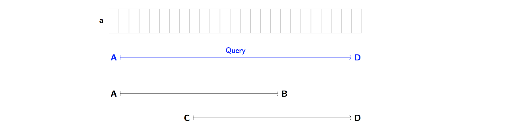
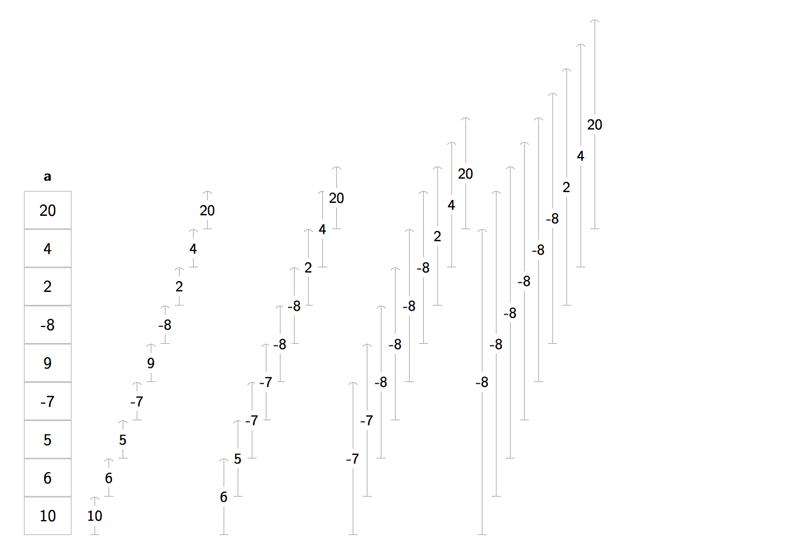
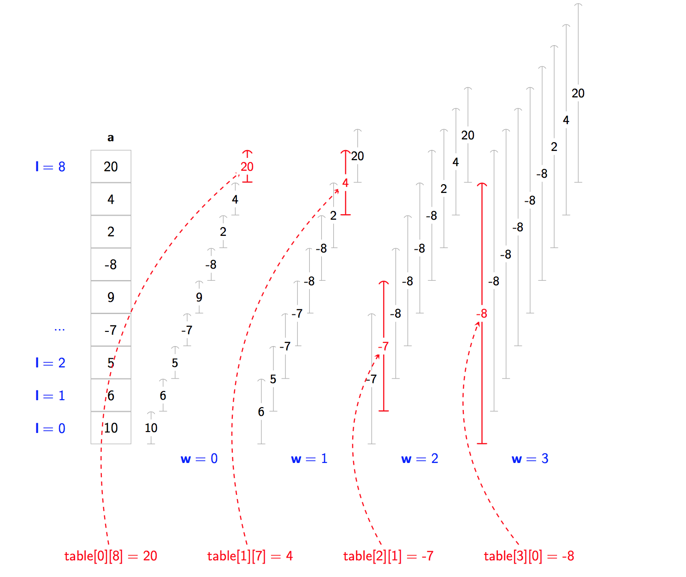
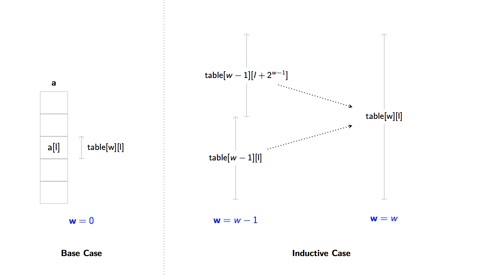
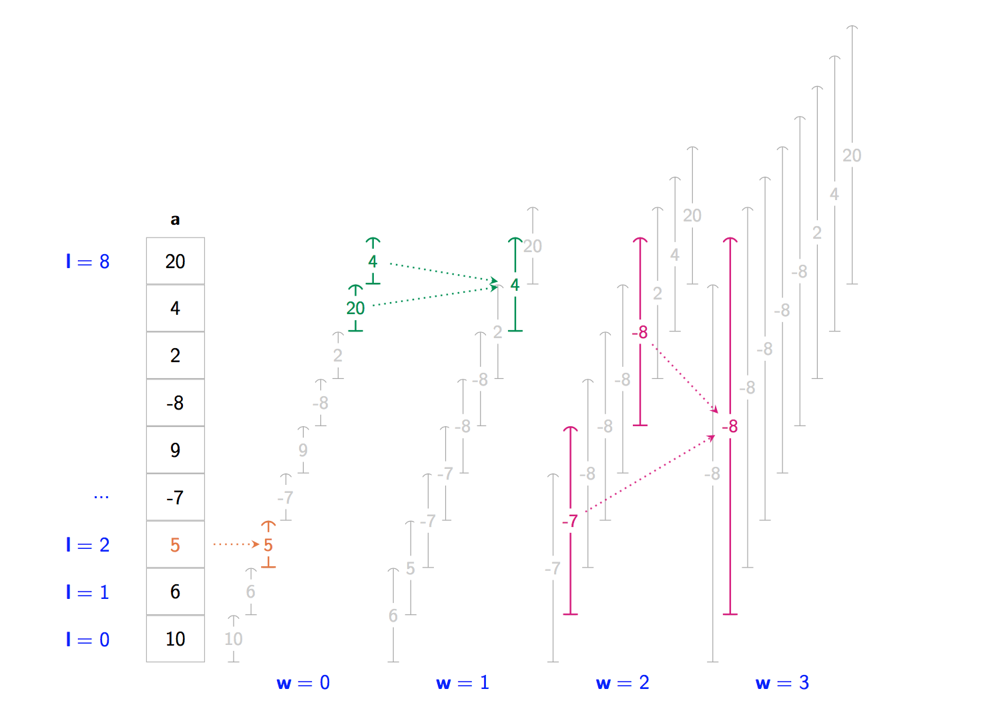
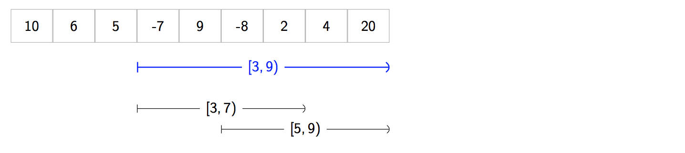
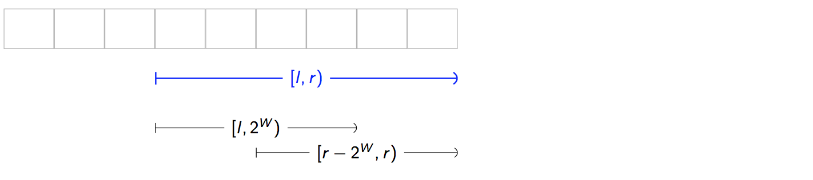

# Sparse Table
# ST(稀疏表)算法

I'm excited to present **Sparse Tables**. Despite being somewhat niche, Sparse Tables are simple to implement and extremely powerful.
我很高兴提出**稀疏表**。 尽管有点利基，但Sparse Tables易于实现且功能非常强大。

### The Problem
### 问题

Let's suppose:
- we have an array **a** of some type
- we have some associative binary function **f** <sup>[\*]</sup>. The function can be: min, max, [gcd](../GCD/), boolean AND, boolean OR ...

我们假设：
- 我们有一个** **某种类型的数组
- 我们有一些关联二元函数**f** <sup>[\*]</sup>。 该函数可以是：min, max, [gcd](../GCD/)，布尔AND，布尔OR ...

*<sup>[\*]</sup> where **f** is also "idempotent". Don't worry, I'll explain this in a moment.*

*<sup>[\*]</sup>其中 **f** 也是“幂等”。 别担心，我马上解释一下。*

Our task is as follows:
我们的任务如下：

- Given two indices **l** and **r**, answer a **query** for the interval `[l, r)` by performing `f(a[l], a[l + 1], a[l + 2], ..., a[r - 1])`; taking all the elements in the range and applying **f** to them
- There will be a *huge* number **Q** of these queries to answer ... so we should be able to answer each query *quickly*!  

- 给定两个索引**l**和 **r**，通过执行 回答一个**查询**的区间 `f(a[l], a[l + 1], a[l + 2], ..., a[r - 1])`; 获取范围内的所有元素并将**f**应用于它们
- 这些查询会有一个 *巨大* 数字**Q**来回答...所以我们应该能够*快速*回答每个查询！

For example, if we have an array of numbers:
例如，如果我们有一个数字数组：

```swift
var a = [ 20, 3, -1, 101, 14, 29, 5, 61, 99 ]
```
and our function **f** is the *min* function.
我们的函数 **f**是*min*函数。

Then we may be given a query for interval `[3, 8)`. That means we look at the elements:
然后我们可以给出一个查询间隔 `[3, 8)`。 这意味着我们看看元素：

```
101, 14, 29, 5, 61
```

because these are the elements of **a** with indices 
that lie in our range `[3, 8)` – elements from index 3 up to, but not including, index 8.
We then we pass all of these numbers into the min function, 
which takes the minimum. The answer to the query is `5`, because that's the result of `min(101, 14, 29, 5, 61)`.

因为这些是具有指数的**a**的元素
它位于我们的范围`[3, 8)` - 索引3的元素，但不包括索引8。
然后我们将所有这些数字传递给min函数，
这是最小的。 查询的答案是`5`，因为这是 `min(101, 14, 29, 5, 61)` 的结果。

Imagine we have millions of these queries to process.
> - *Query 1*: Find minimum of all elements between 2 and 5
> - *Query 2*: Find minimum of all elements between 3 and 9
> - ...
> - *Query 1000000*: Find minimum of all elements between 1 and 4

想象一下，我们有数百万个这样的查询需要处理。
> - *查询1*：查找2到5之间所有元素的最小值
> - *查询2*：查找3到9之间所有元素的最小值
> - ...
> - *查询1000000*：查找1到4之间的所有元素的最小值

And our array is very large. Here, let's say **Q** = 1000000 and **N** = 500000. Both numbers are *huge*. We want to make sure that we can answer each query really quickly, or else the number of queries will overwhelm us! 
我们的数组非常大。 在这里，假设**Q** = 1000000和**N** = 500000.这两个数字都是*巨大*。 我们希望确保我们能够快速回答每个查询，否则查询数量将无法满足我们的需求！

*So that's the problem.* 

The naive solution to this problem is to perform a `for` loop
to compute the answer for each query. However, for very large **Q** and very large **N** this 
will be too slow. We can speed up the time to compute the answer by using a data structure called
a **Sparse Table**. You'll notice that so far, our problem is exactly the same as that of the [Segment Tree](https://github.com/raywenderlich/swift-algorithm-club/tree/master/Segment%20Tree) 
(assuming you're familiar). However! ... there's one crucial difference between Segment Trees
and Sparse Tables ... and it concerns our choice of **f**.

这个问题的天真解决方案是执行`for`循环计算每个查询的答案。 但是，对于非常大的**Q**和非常大的**N**这个太慢了。 我们可以通过使用一个名为的数据结构来加快计算答案的时间
a **稀疏表**。 您会注意到，到目前为止，我们的问题与[Segment Tree](https://github.com/raywenderlich/swift-algorithm-club/tree/master/Segment%20Tree) 的问题完全相同
（假设你很熟悉）。 然而！ ......细分树之间存在一个至关重要的区别
和稀疏表......它涉及我们对**f**的选择。

### A small gotcha ... Idempotency
### 一个小问题...幂等

Suppose we wanted to find the answer to **`[A, D)`**.
And we already know the answer to two ranges  **`[A, B)`** and **`[C, D)`**.
And importantly here, ... *these ranges overlap*!! We have **C** < **B**. 

假设我们想找到**`[A, D]`**的答案。
我们已经知道两个范围的答案**`[A, B)`**和**`[C, D)`**。
而且重要的是，... *这些范围重叠* !! 我们有**C** < **B**。




So what? Well, for **f** = minimum function, we can take our answers for **`[A, B)`** and **`[C, D)`** 
and combine them!
We can just take the minimum of the two answers: `result = min(x1, x2)` ... *voilà!*, we have the minimum for **`[A, D)`**.
It didn't matter that the intervals overlap - we still found the correct minimum.
But now suppose **f** is the addition operation `+`. Ok, so now we're taking sums over ranges.
If we tried the same approach again, it wouldn't work. That is, 
if we took our answers for **`[A, B)`** and **`[C, D)`** 
and added them together we'd get a wrong answer for **`[A, D)`**.
*Why?* Well, we'd have counted some elements twice because of the overlap.

所以呢？ 那么，对于**f** = 最小函数，我们可以得到**`[A, B)`**和**`[C, D)`**的答案
并结合他们！
我们可以取两个答案中的最小值：`result = min(x1, x2)` ... *voilà!*，我们有**`[A, D)`**的最小值。
间隔重叠并不重要 - 我们仍然找到了正确的最小值。
但现在假设**f**是加法运算`+`。 好的，所以现在我们在范围内收取总和。
如果我们再次尝试相同的方法，它将无法工作。 那是，
如果我们把答案换成**`[A, B)`**和**`[C, D)`**
并将它们加在一起我们得到**`[A, D)`**的错误答案。
*为什么？*好吧，由于重叠，我们已经计算了两次元素。

Later, we'll see that in order to answer queries, Sparse Tables use this very technique. 
They combine answers in the same way as shown above. Unfortunately this means
we have to exclude certain binary operators from being **f**, including `+`, `*`, XOR, ...
because they don't work with this technique.
In order to get the best speed of a Sparse Table, 
we need to make sure that the **f** we're using is an **[idempotent](https://en.wikipedia.org/wiki/Idempotence)** binary operator.
Mathematically, these are operators that satisfy `f(x, x) = x` for all possible **x** that could be in **a**. 
Practically speaking, these are the only operators that work; allowing us to combine answers from overlapping ranges.
Examples of idempotent **f**'s are min, max, gcd, boolean AND, boolean OR, bitwise AND and bitwise OR.
Note that for Segment Trees, **f** does not have to be idempotent. That's the crucial difference between
Segment Trees and Sparse Tables.

稍后，我们将看到，为了回答查询，稀疏表使用这种技术。
他们以与上面所示相同的方式组合答案。 不幸的是这意味着
我们必须将某些二元运算符排除在**f**之外，包括`+`，`*`，XOR，......
因为他们不使用这种技术。
为了获得稀疏表的最佳速度，
我们需要确保我们使用的**f**是**[幂等](https://en.wikipedia.org/wiki/Idempotence)**二元运算符。
在数学上，这些运算符满足 `f(x, x) = x` 的所有可能**x**，可能在**a**。
实际上，这些是唯一有效的运营商; 允许我们组合重叠范围的答案。
幂等**f**的示例是min，max，gcd，boolean AND，boolean OR，按位AND和按位OR。
请注意，对于线段树，**f**不必是幂等的。 这是两者之间的关键区别线段树和稀疏表。

*Phew!* Now that we've got that out of the way, let's dive in!
*Phew！*现在我们已经开始了，让我们潜入！

## Structure of a Sparse Table

Let's use **f** = min and use the array:

```swift
var a = [ 10, 6, 5, -7, 9, -8, 2, 4, 20 ]
```

In this case, the Sparse Table looks like this:



What's going on here? There seems to be loads of intervals.
*Correct!* Sparse tables are preloaded with the answers for lots of queries `[l, r)`.
Here's the idea. Before we process our **Q** queries, we'll pre-populate our Sparse Table `table`
with answers to loads of queries;
making it act a bit like a *cache*. When we come to answer one of our queries, we can break the query
down into smaller "sub-queries", each having an answer that's already in the cache. 
We lookup the cached answers for the sub-queries in 
`table` in constant time
and combine the answers together 
to give the overall answer to the original query in speedy time.

这里发生了什么？ 似乎有很多间隔。
*正确！*稀疏表预装了许多查询`[l, r)`的答案。
这是个主意。 在我们处理**Q**查询之前，我们将预先填充我们的稀疏表`table`回答大量的查询;
使它有点像*缓存*。 当我们回答我们的一个查询时，我们可以打破查询分成较小的“子查询”，每个子查询都有一个已经在缓存中的答案。
我们在中查找子查询的缓存答案`table`在恒定的时间并将答案结合在一起在快速的时间内给出原始查询的总体答案。

The problem is, we can't store the answers for every single possible query that we could ever have ... 
or else our table would be too big! After all, our Sparse Table needs to be *sparse*. So what do we do?
We only pick the "best" intervals to store answers for. And as it turns out, the "best" intervals are those 
that have a **width that is a power of two**!

问题是，我们无法存储我们可能拥有的每个可能查询的答案......
否则我们的桌子太大了！ 毕竟，我们的稀疏表需要*稀疏*。 那么我们该怎么办？
我们只选择“最佳”间隔来存储答案。 事实证明，“最佳”间隔就是那些**宽度为2的幂**！

For example, the answer for the query `[10, 18)` is in our table 
because the interval width: `18 - 10 = 8 = 2**3` is a power of two (`**` is the [exponentiation operator](https://en.wikipedia.org/wiki/Exponentiation)).
Also, the answer for `[15, 31)` is in our table because its width: `31 - 15 = 16 = 2**4` is again a power of two.
However, the answer for `[1, 6)` is *not* in there because the interval's width: `6 - 1 = 5` is *not* a power of two.
Consequently, we don't store answers for *all* possible intervals that fit inside **a** –
only the ones with a width that is a power of two. 
This is true irrespective of where the interval starts within **a**.
We'll gradually see that this approach works and that relatively speaking, it uses very little space.

例如，查询`[10, 18)`的答案在我们的表中
因为间隔宽度：`18 - 10 = 8 = 2**3`是2的幂（`**`是[指数运算符](https://en.wikipedia.org/wiki/Exponentiation))。
另外，`[15, 31)`的答案在我们的表中，因为它的宽度：`31 - 15 = 16 = 2 ** 4`再次是2的幂。
但是，`[1, 6)`的答案是*not*因为区间的宽度：`6 - 1 = 5`是*not*是2的幂。
因此，我们不会存储适合**a**的*all*可能间隔的答案 - 只有宽度为2的幂。
无论间隔在**a**内的何处开始，都是如此。
我们将逐渐看到这种方法有效，相对而言，它使用的空间非常小。

A **Sparse Table** is a table where `table[w][l]` contains the answer for `[l, l + 2**w)`.     
It has entries `table[w][l]` where:
- **w** tells us our **width** ... the number of elements or the *width* is `2**w`
- **l** tells us the **lower bound** ... it's the starting point of our interval

**Sparse Table**是一个表，其中`table[w][l]`包含`[l, l + 2**w)`的答案。
它有条目`table[w][l]`其中：
- **w**告诉我们**宽度** ...元素数量或*宽度*是`2**w`
- **l**告诉我们**下界** ...它是我们间隔的起点

Some examples:
- `table[3][0] = -8`: our width is `2**3`, we start at `l = 0` so our query is `[0, 0 + 2**3) = [0, 8)`.    
   The answer for this query is `min(10, 6, 5, -7, 9, -8, 2, 4, 20) = -8`.
- `table[2][1] = -7`: our width is `2**2`, we start at `l = 1` so our query is  `[1, 1 + 2**2) = [1, 5)`.    
   The answer for this query is `min(6, 5, -7, 9) = -7`.
- `table[1][7] = 4`: our width is `2**1`, we start at `l = 7` so our query is `[7, 7 + 2**1) = [7, 9)`.     
   The answer for this query is `min(4, 20) = 4`.
- `table[0][8] = 20`: our width is `2**0`, we start at `l = 8` so our query is`[8, 8 + 2**0) = [8, 9)`.    
   The answer for this query is `min(20) = 20`.





A Sparse Table can be implemented using a [two-dimentional array](../2D%20Array).    

```swift
public class SparseTable<T> {
  private var table: [[T]]

  public init(array: [T], function: @escaping (T, T) -> T, defaultT: T) {
      table = [[T]](repeating: [T](repeating: defaultT, count: N), count: W)
  }
  // ...    
}
```


## Building a Sparse Table

To build a Sparse Table, we compute each table entry starting from the bottom-left and moving up towards
the top-right (in accordance with the diagram).
First we'll compute all the intervals for  **w** = 0, then compute all the intervals
and for **w**  = 1 and so on. We'll continue up until **w** is big enough such that our intervals are can cover at least half the array.
For each **w**, we compute the interval for **l** = 0, 1, 2, 3, ... until we reach **N**.
This is all achieved using a double `for`-`in` loop:

为了构建稀疏表，我们计算从左下角开始向上移动的每个表条目右上角（按照图表）。
首先，我们将计算**w** = 0的所有间隔，然后计算所有间隔
对于**w** = 1等等。 我们将继续向上，直到**w**足够大，使得我们的间隔可以覆盖至少一半的阵列。
对于每个**w**，我们计算**l** = 0, 1, 2, 3 ......的间隔，直到达到 **N**。
这都是使用double`for`-`in`循环实现的：

```swift
for w in 0..<W {
  for l in 0..<N {
    // compute table[w][l]
  }
}
```

To compute `table[w][l]`:

- **Base Case (w = 0)**: Each interval has width `2**w = 1`. 
    - We have *one* element intervals of the form: `[l, l + 1)`. 
    - The answer is just `a[l]` (e.g. the minimum of over a list with one element 
is just the element itself).
      ```
      table[w][l] = a[l]
      ``` 
- **Inductive Case (w > 0)**: We need to find out the answer to `[l, l + 2**w)` for some **l**. 
This interval, like all of our intervals in our table has a width that
is a power of two (e.g.  2, 4, 8, 16) ... so we can cut it into two equal halves.
    - Our interval with width ``2**w`` is cut into two intervals, each of width ``2**(w - 1)``.
    - Because each half has a width that is a power of two, we can look them up in our Sparse Table.
    - We combine them together using **f**. 
        ```
        table[w][l] = f(table[w - 1][l], table[w - 1][l + 2 ** (w - 1)])
        ```     




For example for `a = [ 10, 6, 5, -7, 9, -8, 2, 4, 20 ]` and **f** = *min*:

- we compute `table[0][2] = 5`. We just had to look at `a[2]` because the range has a width of one.
- we compute `table[1][7] = 4`. We looked at `table[0][7]` and `table[0][8]` and apply **f** to them.
- we compute `table[3][1] = -8`. We looked at `table[2][1]` and `table[2][5]` and apply **f** to them.





```swift
public init(array: [T], function: @escaping (T, T) -> T, defaultT: T) {
 let N = array.count
 let W = Int(ceil(log2(Double(N))))
 table = [[T]](repeating: [T](repeating: defaultT, count: N), count: W)
 self.function = function
 self.defaultT = defaultT

 for w in 0..<W {
   for l in 0..<N {
     if w == 0 {
       table[w][l] = array[l]
     } else {
       let first = self.table[w - 1][l]
       let secondIndex = l + (1 << (w - 1))
       let second = ((0..<N).contains(secondIndex)) ? table[w - 1][secondIndex] : defaultT
       table[w][l] = function(first, second)
     }
   }
 }
}
```

Building a Sparse Table takes **O(NlogN)** time.    
The table itself uses **O(NlgN)** additional space.

## Getting Answers to Queries
## 获取查询答案

Suppose we've built our Sparse Table. And now we're going to process our **Q** queries.
Here's where our work pays off.
假设我们已经构建了稀疏表。 现在我们将处理我们的**Q**查询。
这是我们的工作得到回报的地方。

Let's suppose **f** = min and we have: 
```swift
var a = [ 10, 6, 5, -7, 9, -8, 2, 4, 20 ]
```
And we have a query `[3, 9)`.

1. First let's find the largest power of two that fits inside `[3, 9)`. Our interval has width `9 - 3 = 6`. So the largest power of two    that fits inside is four. 
2. We create two new queries of `[3, 7)` and `[5, 9)` that have a width of four.
   And, we arrange them so that to that they span the whole interval without leaving any gaps.
   

3. Because these two intervals have a width that is exactly a power of two we can lookup their answers in the Sparse Table using the 
   entries for **w** = 2. The answer to `[3, 7)` is given by `table[2][3]`, and the answer to `[5, 9)` is given by `table[2][5]`.
   We compute and return `min(table[2][3], table[2][5])`. This is our final answer! :tada:. Although the two intervals overlap, it doesn't matter because the **f** = min we originally chose is idempotent.

1. 首先让我们找到适合`[3, 9)`里面的两个最大的力量。 我们的间隔宽度为`9 - 3 = 6`。 因此，适合内部的两个最大的力量是四个。
2. 我们创建了两个新的查询：`[3, 7)`和`[5, 9)`，宽度为4。
    并且，我们安排它们，以便它们跨越整个间隔而不留任何间隙。
    ！[稀疏表](Images/query_example.png)

3. 因为这两个区间的宽度恰好是2的幂，我们可以使用。在稀疏表中查找它们的答案
    **w** = 2的条目`[3, 7)`的答案由`table[2][3]`给出，`[5, 9)`的答案由`table[2][5]`。
    我们计算并返回`min(table[2][3], table[2][5])`。 这是我们的最终答案！:tada:。 虽然两个区间重叠，但无关紧要，因为我们最初选择的 **f** = min是幂等的。

In general, for each query: `[l, r)` ...

1. Find **W**, by looking for the largest width that fits inside the interval that's also a power of two. Let largest such width = `2**W`.
2. Form two sub-queries of width `2**W` and arrange them to that they span the whole interval without leaving gaps.
   To guarantee there are no gaps, we need to align one half to the left and the align other half to the right.
   
3. Compute and return `f(table[W][l], table[W][r - 2**W])`.

1. 找到 **W**，寻找适合于间隔内的最大宽度，也就是2的幂。 让最大的宽度=`2**W`。
2. 形成宽度为`2**W`的两个子查询，并将它们排列成它们跨越整个区间而不留下间隙。
    为了保证没有间隙，我们需要将一半对齐到左边，将另一半对齐到右边。
    ！[稀疏表](Images/query.png)
3. 计算并返回 `f(table[W][l], table[W][r - 2**W])`。

      ```swift
      public func query(from l: Int, until r: Int) -> T {
        let width = r - l
        let W = Int(floor(log2(Double(width))))
        let lo = table[W][l]
        let hi = table[W][r - (1 << W)]
        return function(lo, hi)
     }
      ```

Finding answers to queries takes **O(1)** time.
查找查询答案需要**O(1)**时间。

## Analysing Sparse Tables
## 分析稀疏表

- **Query Time** - Both table lookups take constant time. All other operations inside `query` take constant time. 
So answering a single query also takes constant time: **O(1)**. But instead of one query we're actually answering **Q** queries, 
and we'll need time to built the table before-hand.
Overall time is: **O(NlgN + Q)** to build the table and answer all queries. 
The naive approach is to do a for loop for each query. The overall time for the naive approach is: **O(NQ)**. 
For very large **Q**, the naive approach will scale poorly. For example if `Q = O(N*N)`
then the naive approach is `O(N*N*N)` where a Sparse Table takes time `O(N*N)`.
- **Space**-  The number of possible **w** is **lgN** and the number of possible **l** our table is **N**. So the table
has uses **O(NlgN)** additional space.

- **查询时间** - 两个表查找都需要恒定的时间。 `query`中的所有其他操作都需要恒定的时间。
因此，回答单个查询也需要持续时间：**O(1)**。 但是，我们实际上回答了**Q**查询而不是一个查询，
我们需要时间来预先制作表格。
总时间是：**O(NlgN + Q)**构建表并回答所有查询。
天真的方法是为每个查询执行for循环。 天真方法的总时间是：**O(NQ)**。
对于非常大的**Q**，天真的方法将很难扩展。 例如，如果`Q = O(N*N)`
那么天真的方法是 `O(N*N*N)` ，其中稀疏表需要时间 `O(N*N)`。
- **空格** - 可能的**w**的数量是**lgN**，我们的表格可能**l**的数量是 **N**。 所以表已使用**O(NlgN)**额外空间。

### Comparison with Segment Trees
### 与线段树的比较

- **Pre-processing** - Segment Trees take **O(N)** time to build and use **O(N)** space. Sparse Tables take **O(NlgN)** time to build and use **O(NlgN)** space.
- **Queries** - Segment Tree queries are **O(lgN)** time for any **f** (idempotent or not idempotent). Sparse Table queries are **O(1)** time if **f** is idempotent and are not supported if **f** is not idempotent. <sup>[†]</sup>
- **Replacing Items** - Segment Trees allow us to efficiently update an element in **a** and update the segment tree in **O(lgN)** time. Sparse Tables do not allow this to be done efficiently. If we were to update an element in **a**, we'd have to rebuild the Sparse Table all over again in **O(NlgN)** time.

- **预处理** - 段树需要**O(N)**时间来构建和使用**O(N)**空间。 稀疏表需要**O(NlgN)**时间来构建和使用**O(NlgN)**空间。
- **查询** - 对于任何**f**（幂等或非幂等），段树查询都是**O(lgN)**时间。 如果**f**是幂等的，则稀疏表查询是**O(1)**时间，如果**f**不是幂等的，则不支持稀疏表查询。<sup>[†]</sup>
- **替换项** - 段树允许我们有效地更新**a**中的元素并以**O(lgN)**时间更新段树。 稀疏表不允许有效地完成此操作。 如果我们要更新**a**中的元素，我们必须在**O(NlgN)**时间内重新重建稀疏表。


<sup>[†]</sup> *Although technically, it's possible to rewrite the `query` method 
to add support for non-idempotent functions. But in doing so, we'd bump up the time up from O(1) to O(lgn), 
completely defeating the original purpose of Sparse Tables - supporting lightening quick queries. 
In such a case, we'd be better off using a Segment Tree (or a Fenwick Tree)*

<sup>[†]</sup> *虽然从技术上讲，可以重写`query`方法添加对非幂等函数的支持。 但是这样做，我们会把时间从O(1)提高到O(lgn)，彻底打败稀疏表的最初目的 - 支持闪电快速查询。在这种情况下，我们最好使用Segment Tree（或Fenwick Tree）*

## Summary
## 摘要

That's it! See the playground for more examples involving Sparse Tables.
You'll see examples for: min, max, gcd, boolean operators and logical operators. 

而已！ 有关涉及稀疏表的更多示例，请参阅playground。
您将看到以下示例：min，max，gcd，布尔运算符和逻辑运算符。

### See also
### 扩展阅读

- [Segment Trees (Swift Algorithm Club)](https://github.com/raywenderlich/swift-algorithm-club/tree/master/Segment%20Tree)
- [How to write O(lgn) time query function to support non-idempontent functions (GeeksForGeeks)](https://www.geeksforgeeks.org/range-sum-query-using-sparse-table/) 
- [Fenwick Trees / Binary Indexed Trees (TopCoder)](https://www.topcoder.com/community/data-science/data-science-tutorials/binary-indexed-trees/) 
- [Semilattice (Wikipedia)](https://en.wikipedia.org/wiki/Semilattice)

*Written for Swift Algorithm Club by [James Lawson](https://github.com/jameslawson)*  
*作者：[James Lawson](https://github.com/jameslawson)*  
*翻译：[Andy Ron](https://github.com/andyRon)*  
